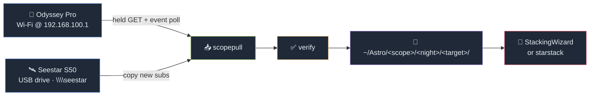
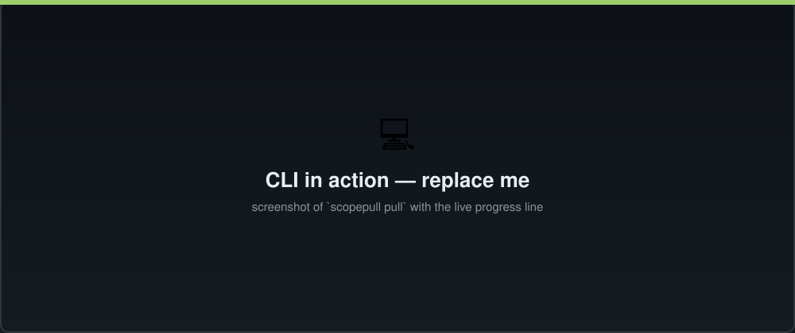
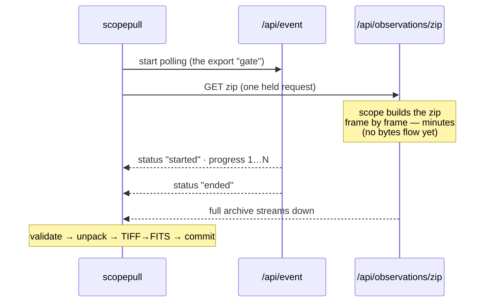
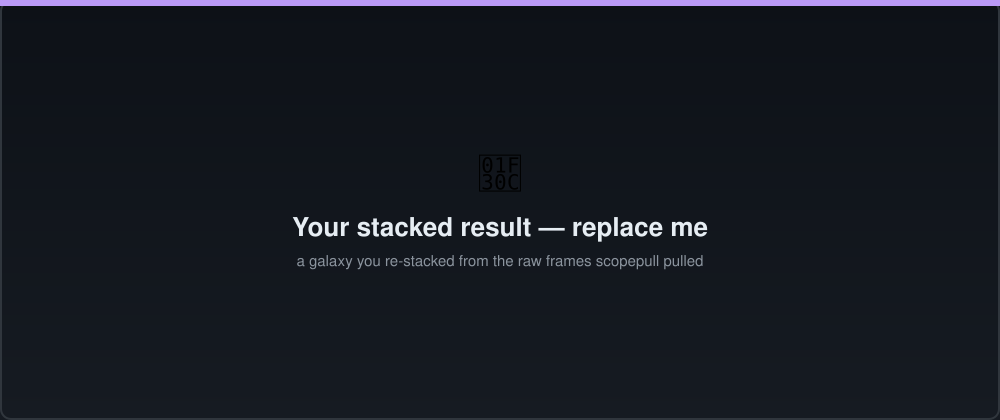

<div align="center">


# 🔭 scopepull

**Gets the night off your smart scope.**

[](https://pypi.org/project/scopepull/)
[](https://github.com/kylefoxaustin/scopepull/actions/workflows/ci.yml)
[](pyproject.toml)
[](#-install)
[](LICENSE)

*Tick your scope. Press the button. Every sub-frame you don't already have lands on disk, filed by
night and target, ready for a stacker — Unistellar **Odyssey Pro** over its Wi-Fi API, ZWO
**Seestar S50 / S50 Pro** over USB or its share.*

</div>

---

- 🟢 **One command, or one button** — `scopepull` pulls everything new; `scopepull gui` opens the
  owl, who does the same thing with a bigger button. Safe to re-run: it only ever takes what's
  missing, and it never writes to the scope.
- 🔭 **More than one telescope** — the Odyssey Pro's HTTP API and the Seestar's folder-full-of-subs
  behind the same four commands. A Dwarf is next.
- 🧬 **Raw science data** — deep-sky frames as raw **Bayer** mosaics, with FITS headers filled in
  (`BAYERPAT`, `EXPTIME`, `GAIN`, `RA`/`DEC`, `DATE-OBS`). The Odyssey's `BAYERPAT` is **measured
  from the pixels** — the export is **RGGB as stored** even though the sensor is GBRG (see
  [docs/API.md](docs/API.md#bayer-pattern)).
- 📒 **An archive, not a download folder** — `<root>/<night>/<target>/`, one target per night, with
  the master dark and the scope's own stack alongside the Odyssey's frames. `scopepull index` says
  what you've got; `scopepull combine` gathers every night of one target into a single folder a
  stacker can swallow, as hard links, for free.

---

> ### 🙏 Standing on prior art
> The hard part — reverse-engineering the Odyssey's HTTP API — began with
> [**vamshikesireddy/unistellar-data-downloader**](https://github.com/vamshikesireddy/unistellar-data-downloader)
> (MIT), which discovered the crucial trick: **the backend won't stream data unless a client is
> concurrently polling `/api/event`.** scopepull builds on that knowledge (fully documented in
> [docs/API.md](docs/API.md)) with a rewritten async, manifest-aware pipeline. **Just want simple
> "pick observations, get zips"? Use their tool** — it's excellent at exactly that. scopepull is for
> the archival-sync use case: idempotent re-runs, verified atomic ingest, an organized archive, and
> the biggest observations pulled reliably where the browser drops them.
>
> The owl, his window, the archive table and the StackingWizard hand-off came from
> [**starstack**](https://github.com/kylefoxaustin/starstack), where they were built and field-tested
> first. See [docs/THE_OWL_MOVES_IN.md](docs/THE_OWL_MOVES_IN.md).

---

## ✨ What it does



<div align="center">

</div>

---

## 🦉 The owl

`scopepull gui` (or `scopepull.exe`, or `scopepull-gui`) is one window: tick a scope, press the big
red button, watch the night land in the table underneath. Pick a night there — or a target, and all
its nights at once — and hand it to a stacker.

- **One screen.** No wizard, no project files. The log is the log; the archive is a table of targets
  and nights with frame counts, integration time and how long ago each was pulled.
- **Stop means stop.** The pull runs as a child process inside a Windows job object, so closing the
  window — or killing it from Task Manager — takes the download with it. Pause and resume work too.
- **Open in StackingWizard** hands the selected folder to
  [StackingWizard](https://astrowizard.lukomatico.com/stackingwizard.html): it launches it, puts the
  path on your clipboard for its folder picker, and opens the folder so you can drag it across.
  Several nights of one target get combined first.
- **Quick look** (optional) stacks what just landed with
  [starstack](https://github.com/kylefoxaustin/starstack), rough and fast, just to see whether the
  night was worth keeping. Without starstack installed the owl is purely a puller, and says so.

---

## 🚀 Install

### Windows, no Python

Grab `scopepull-<version>-windows.exe` from the
[latest release](https://github.com/kylefoxaustin/scopepull/releases), double-click it, and the owl
opens. One file; Python and everything else are inside it. No installer, nothing in the registry,
no account anywhere — delete the file and it's gone. `scopepull.exe --cli …` is the full command
line, same as below.

<details>
<summary><b>Why the blue box, and the checksum</b></summary>

Windows trusts programs that are code-signed, and a signing certificate costs real money every
year; this is a hobby project, so the exe isn't signed and SmartScreen will ask every time you
download a new version, not just the first. What you get instead is a checksum: every release has a
`SHA256SUMS.txt` beside the exe and the same hash in its notes. In PowerShell,
`Get-FileHash scopepull-<version>-windows.exe` should print that hash; if it doesn't, you don't
have the file that release built.

Windows Defender may go further and call a release a virus (`Wacatac`, `Wacapew`, anything ending
in `!ml`). That's the heuristic reacting to how PyInstaller packs a program — thousands of Python
apps share the same launcher bytes, so when one of *those* is bad they all get flagged for a while.
Releases here are built with a launcher compiled fresh on the build machine to avoid exactly that
(see [`.github/workflows/release.yml`](.github/workflows/release.yml)); if it still happens,
Windows Security → Protection history → Allow, or build it yourself. Nothing in scopepull phones
home, installs anything, or touches a thing outside the archive folder you point it at.
</details>

### Anywhere, with Python 3.11+

```bash
uv tool install scopepull      # or:  pipx install scopepull  /  pip install scopepull
```
<sub>Or from source: `git clone` + `uv sync`, then `uv run scopepull …`</sub>

---

## ⚡ Quickstart

```bash
scopepull gui                       # 🦉 the window, if you'd rather press a button

# Unistellar Odyssey Pro — over the scope's own Wi-Fi
#   (enable Direct Data Download in the app once; the scope remembers)
scopepull doctor                    # ✅ connectivity + DDD + free-disk check
scopepull                           # ⬇️  pull everything new off the Odyssey

# ZWO Seestar S50 / S50 Pro — a drive, or a share
scopepull find --scope seestar      # 🔎 USB drive? \\seestar? where is it
scopepull pull --scope seestar      # ⬇️  copy every sub the archive hasn't got

# either way
scopepull status                    # 📦 both archives, at a glance
scopepull index --all-scopes        # 🧾 every session as JSON, one per line
scopepull combine "NGC 7000"        # 🔗 all its nights in one folder, hard-linked
```

---

## 🛰️ The Seestar

A Seestar isn't a portal, it's a folder. Every target has a `MyWorks/<target>_sub/` full of `.fit`
subs, and scopepull copies the ones your archive is missing into
`~/Astro/seestar/<night>/<target>/`. Nights split at **noon**, so a session that runs through
midnight stays one night. Read-only on the scope, always.

Left behind on purpose: the `.jpg` twins and `_thn.jpg` thumbnails (previews, not data), the scope's
own `Stacked_*.fit`, and `Lunar_*` / `Solar_*` / `*_video` folders. **Mosaics do come across** —
framing mode is real data, and StackingWizard tiles it.

`--at` says where to look, when looking isn't enough:

```bash
scopepull pull --scope seestar --at D:                       # a USB drive
scopepull pull --scope seestar --at 10.0.1.215               # by IP, on Wi-Fi
scopepull pull --scope seestar --at '\\seestar\EMMC Images'  # the share itself
```

<details>
<summary><b>Seestar over Wi-Fi on Windows 11</b></summary>

The scope's share is an old-fashioned one — no password, and it can't sign its traffic — and since
the 24H2 update Windows refuses both by default, so `\\seestar` looks like it doesn't exist even
though `ping seestar` answers. Two settings fix it, once, in an **administrator** PowerShell (no
reboot):

```powershell
Set-SmbClientConfiguration -RequireSecuritySignature $false -Force
Set-SmbClientConfiguration -EnableInsecureGuestLogons $true -Force
```

Those loosen your laptop's file-sharing client for every share it talks to, which is fine on a home
network and is the trade every Seestar owner on a current Windows makes. scopepull does the
remaining step itself (the guest login that `net use \\seestar\IPC$ /user:guest` would do by hand),
so after those two lines the Seestar just works. **USB needs none of this.**
</details>

---

## 🧩 How the Odyssey works (the cracked protocol)

The scope builds each export **frame-by-frame on its own hardware** (~1 frame/sec) and only streams
the finished zip over a **single held HTTP GET** — while a concurrent event-poll keeps the "gate"
open. Getting this exactly right is what makes big pulls reliable:



> 💡 **Two hard-won rules** (see [docs/API.md](docs/API.md)): **never** `cancelDownload` before the
> GET (it suppresses the build), and keep the socket alive with TCP keepalive so a long idle build
> doesn't get its connection reset.

---

## 🏗️ Architecture

```mermaid
flowchart TD
    GUI["gui.py — the owl (tkinter)"] -.runs as a subprocess.-> CLI
    CLI["cli.py — typer + rich"] --> SCOPES
    subgraph SCOPES["🔭 scopes/ — four questions, per telescope"]
        OD["odyssey.py<br/>find · pull"]
        SE["seestar.py<br/>find · pull"]
        DW["dwarf.py<br/>(December)"]
    end
    OD --> SC["client.py<br/>httpx + event pump + keepalive"] --> TR["transfer.py<br/>held GET, stream, verify"] --> ING["ingest.py<br/>unpack · TIFF→FITS · atomic"] --> MAN["manifest.py<br/>SQLite: what's local"]
    SE --> FS["fsutil.py<br/>copy · retrying rename"]
    SCOPES --> AR["archive.py<br/>index · combine"]
    SC -.SSID / Wi-Fi.-> plat["platform/ — nmcli · netsh"]
    style SCOPES fill:#0d1117,stroke:#9ece6a
```



A scope answers four questions — where its archive lives, where the scope is, what it has that we
don't, and whether the pull worked — and nothing above that layer knows which telescope it's
talking to. The exit codes are the contract every scope keeps: **0** ok, **2** nothing new, **3**
unreachable, **4** Direct Data Download off, **5** partial. [starstack](docs/STARSTACK.md) and the
window both read them.

Everything OS-specific lives in `platform/`; the pull → verify → ingest pipeline is pure, async, and
identical on Linux and Windows.

---

## 📂 What lands on disk

**Odyssey** — each observation is a self-contained folder: raw frames, calibration, the scope's
reference stack, full metadata.

```
~/Astro/odyssey/2026-01-31/m81-bode-s-galaxy__38102043/
├── frames/
│   ├── ..._StackInput.tiff      # 🧬 raw Bayer light frames (RGGB as stored)
│   └── ..._StackInput.fits      # ➕ same data as FITS (BAYERPAT, EXPTIME, RA/DEC…)
├── calibration/
│   ├── ..._DarkframeMean.tiff   # 🌑 master dark
│   └── ..._DarkframeMean.fits
├── reference/
│   ├── ..._StackSum.tiff        # 🔭 the scope's OWN stacked result
│   └── preview.jpg              # 👁️ quick-look
├── observation.json             # 📄 all metadata + pull info
└── SHA256SUMS                   # 🔐 integrity
```

**Seestar** — the subs, as the scope wrote them, filed by night and target.

```
~/Astro/seestar/2026-09-22/NGC 7000/
└── Light_NGC 7000_10.0s_LP_20260922-203537.fit    # 🧬 3840×2160 16-bit, BAYERPAT GRBG
```

**Either** — `index` reads both, and `combine` gathers a target's nights into one folder without
copying a byte:

```
~/Astro/seestar/combined/NGC 7000/      # 🔗 hard links into the nights; delete it any time
```

**Why the Odyssey's calibration set matters:** you get the raw lights **+** the dark **+** the
scope's own stack — so you can calibrate and re-stack yourself, then compare against the scope's
result. *"Did Deep Dark eat my nebula's outer shell?"* — now you can actually check.

<div align="center">

</div>

---

## 🛠️ CLI reference

| Command | What it does |
|---|---|
| `scopepull` | Pull everything **new** off the Odyssey (== `pull --new`) |
| `scopepull pull [--scope NAME] [--at SPEC] [--new\|--all] [--since DATE] [--target TEXT] [--dest DIR]` | Pull, filtered |
| `scopepull find [--scope NAME] [--at SPEC]` | Where is that scope right now? |
| `scopepull index [--scope NAME] [--all-scopes] [--root DIR]` | Every session as JSON, one per line |
| `scopepull combine TARGET [--nights A,B] [--scope NAME]` | All its nights in one folder (hard links) |
| `scopepull gui` | 🦉 the owl |
| `scopepull list [--json]` | Odyssey: what's on the scope, and what's already local |
| `scopepull doctor` | Odyssey: connectivity + DDD + free-disk preflight |
| `scopepull status [--json]` | Both archives, at a glance |
| `scopepull cancel` | Odyssey: clear a stuck server-side job |

`--scope` is `odyssey` (the default, so bare `scopepull` never changed meaning) or `seestar`.
Archive roots default to `~/Astro/<scope>` and can be set per scope in `config.toml`:

```toml
scope_ip = "192.168.100.1"

[archive_roots]
odyssey = "D:/Astro/odyssey"
seestar = "D:/Astro/seestar"
```

---

## ⚠️ Things that matter

- **Odyssey: enable Direct Data Download first** — Unistellar app → Settings → your telescope →
  Download → Direct Data Download. The scope remembers it.
- **Don't operate the scope while pulling.** Interrupted transfers have been seen to lose
  observations *on the scope itself* — scopepull snapshots the catalog and is transactional, but be
  kind to the link.
- **Odyssey: no USB data path.** The USB-A port is power-out only; Wi-Fi is the only way in. (The
  Seestar is the opposite: USB is the fast, boring, reliable way.)
- **The Odyssey's Wi-Fi is ~10 m, 2.4 GHz, and Pi-class.** Big observations take minutes to build
  server-side before they stream — that's normal; the progress line shows the build.

### 🧯 Reliable pulls on a flaky link (field-tested tips)

<details>
<summary><b>Big pulls drop mid-transfer on Windows</b></summary>

Two common culprits, both fixable:
- **USB Wi-Fi adapter power-saving** — disable it (Device Manager → *USB Root Hub* → Power
  Management, and set the wireless adapter to Maximum Performance in the power plan).
- **Windows dropping the "no-internet" scope network** — set `fMinimizeConnections = 0` under
  `HKLM\SOFTWARE\Policies\Microsoft\Windows\WcmSvc\GroupPolicy` (or `gpedit`: Network → Windows
  Connection Manager → *Minimize simultaneous connections* → allow). ⚠️ Don't restart the WLAN
  service to apply it — reboot instead.
</details>

<details>
<summary><b>Dual-homing: internet + scope at the same time</b></summary>

Give each radio one job so they can't fight:
- **Adapter A → your normal Wi-Fi/Ethernet** (internet).
- **Adapter B → the scope only.** Remove your home-Wi-Fi profile *from adapter B* so it can't roam
  off the scope mid-pull.

This is exactly how the biggest observation (710 frames, 2.3 GB) was pulled reliably.
</details>

---

## 🧮 Stacking

scopepull doesn't stack. It gets the night off the scope and files it so something else can:

- **[StackingWizard](https://astrowizard.lukomatico.com/stackingwizard.html)** — the real one, and
  what the owl's green button hands a night to. Mosaics with distortion correction, flats, mono
  filters, a release a week.
- **[starstack](https://github.com/kylefoxaustin/starstack)** — the quick look. Point it at an
  archive folder and it stacks every session in it, skipping ones it's already done. Install it and
  the owl's quick-look checkbox turns on. [docs/STARSTACK.md](docs/STARSTACK.md) is the contract
  between the two.

---

## 🧪 Development

```bash
uv sync --group dev
uv run pytest                  # 74 tests, incl. a FastAPI mock of the Odyssey's protocol
uv run ruff check src tests
uv run mypy
uv run python scripts/gui_smoke.py    # the window, driven through a synthetic scope (needs a display)
```

CI runs the suite on **ubuntu-latest + windows-latest** × Python 3.11/3.12. Tagging `v*` builds the
wheel, publishes to PyPI, builds `scopepull.exe`, runs `smoke_frozen.py` against the built exe, and
attaches it with its SHA256 to a GitHub Release.

---

## 📜 License

MIT — see [LICENSE](LICENSE). Built for [Unistellar](https://www.unistellar.com/) Odyssey / Odyssey
Pro (and any `evsoft` scope: eVscope, eQuinox) and the [ZWO](https://www.zwoastro.com/) Seestar S50
/ S50 Pro. Not affiliated with either.

<div align="center">
<sub>🌌 Go stack some galaxies.</sub>
</div>
